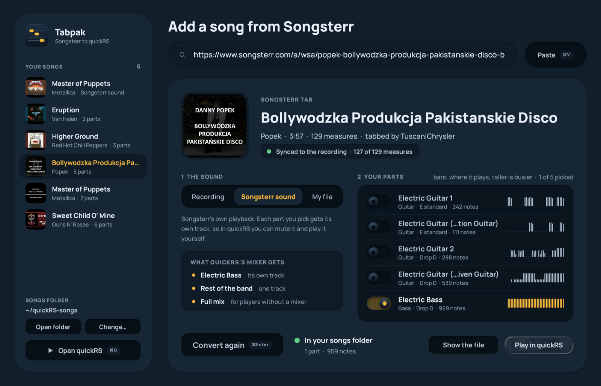
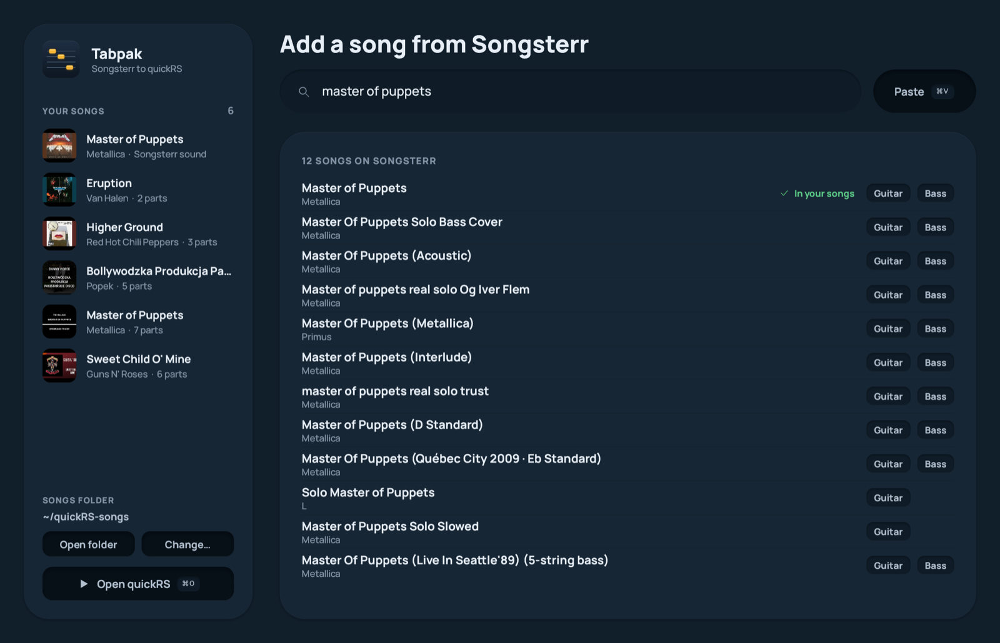
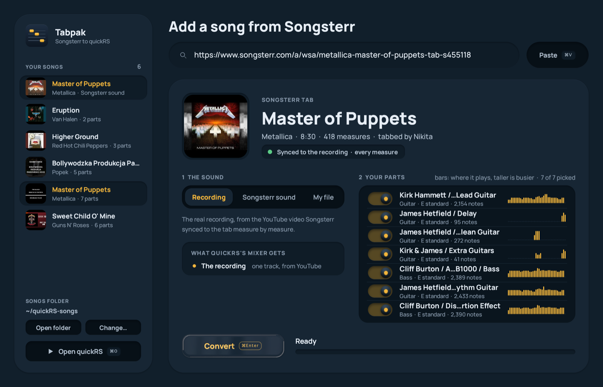

# Tabpak

Tabpak turns a [Songsterr](https://www.songsterr.com) tab into a song you can play in [quickRS](https://github.com/arpan2711/quickRS-player). Paste a link or type a song's name, switch on your parts, press Convert. It is for guitar and bass players who use quickRS and want a song that has a tab on Songsterr but no chart yet.



## What you get

- **Every guitar and bass part** of the tab, with its tuning, capo, bends, slides, hammer-ons, palm mutes, harmonics and chords, as a [feedpak](https://github.com/got-feedback/feedpak-spec) file.
- **Three kinds of sound**, your pick per song:
  - **Recording**: the real recording, from the YouTube video Songsterr synced to the tab measure by measure. Notes land where the band plays them. A private or removed video is skipped and the next synced one is used.
  - **Songsterr sound**: Songsterr's own playback. Each part you pick gets its own track, next to "Rest of the band" and a full mix, so quickRS's mixer can mute your part while you play it. The notes follow the tab's own tempo the way Songsterr's player does: tempo changes, swing, fermatas, grace notes, pickup measures and repeats. After each conversion Tabpak checks every part's notes against its sound and tells you when they are out of step.
  - **My file**: your own audio file, with the notes placed by Songsterr's sync for the song's video. A field shifts the notes when your file starts earlier or later.
- **A look at each part before you convert**: tuning, note count, and a strip that shows where in the song the part plays.
- **Your songs in one list**, with a key that opens quickRS.

| Search by name | A song with many parts |
| --- | --- |
|  |  |

Tabpak wears quickRS's own look: it draws with quickRS's `qrs-ui` crate and follows the theme you set in quickRS.

## Status

In use on macOS. On Linux the tests pass and the terminal commands convert songs; the window is not tried there. Windows: not tried.

## Install and run

You need:

- Rust 1.98 or newer ([rustup.rs](https://rustup.rs)).
- [quickRS](https://github.com/arpan2711/quickRS-player), to play the songs.
- [yt-dlp](https://github.com/yt-dlp/yt-dlp) on your `PATH`, only for the Recording sound (`brew install yt-dlp`). Songsterr sound and My file work without it.

Run it from a checkout:

```sh
cargo run --release
```

On a Mac, build the app and put it in Applications:

```sh
./scripts/bundle-mac.sh /Applications
```

Songs go to `~/quickRS-songs`. If quickRS does not look there yet, the sidebar shows a key that adds the folder to quickRS's song folders.

## Use

In the window:

1. Paste a Songsterr link (`Ctrl V`, `⌘V` on a Mac), or type a song or artist and pick it from the list. A link to a bass tab switches on the bass part; a link to a guitar tab, the guitar parts.
2. Pick the sound and switch your parts on or off.
3. Press Convert (`Ctrl Enter`). The song lands in your songs folder; "Play in quickRS" opens quickRS.

From a terminal, the same binary takes commands:

```sh
tabpak search master of puppets
tabpak info https://www.songsterr.com/a/wsa/metallica-master-of-puppets-tab-s455118
tabpak convert https://www.songsterr.com/a/wsa/metallica-master-of-puppets-tab-s455118 --only bass --audio songsterr
```

`tabpak convert` takes:

| Flag | Meaning |
| --- | --- |
| `--only bass\|guitar` | Convert only these parts. Without it: the kind the link names, else all. |
| `--audio recording\|songsterr\|<file>` | Where the sound comes from. Without it: `recording`. |
| `--video <YouTube id>` | Take the recording and its sync from this video. |
| `--out <folder>` | Where the file goes. Without it: `~/quickRS-songs`. |
| `--offset <seconds>` | Move every note later; a negative number moves them earlier. |

## Map of the repo

| Path | What it holds |
| --- | --- |
| `src/songsterr.rs` | Songsterr's pages and files: search, a song's parts, tab data, synced videos. |
| `src/chart.rs` | Tab to chart: repeats unrolled, notes and techniques, note times from the tab's tempo as Songsterr's player counts them, measure times from the sync points. |
| `src/audio.rs` | Sound in and out: yt-dlp download, decoding (AAC, Opus, MP3, FLAC, WAV, Ogg), mixing, Ogg Vorbis encoding, covers. |
| `src/feedpak.rs` | The feedpak file: manifest, zip, and reading back the songs already made. |
| `src/convert.rs` | One conversion from start to end, the check of notes against Songsterr's sound, and quickRS's song folders. |
| `src/ui.rs` | The window. |
| `src/cli.rs` | The terminal commands. |
| `examples/shots.rs` | Draws every state of the window to PNG files without opening a window. |
| `tests/window.rs` | Draws the window's offline states headless. |
| `tests/golden.rs`, `tests/golden/timing.jsonl` | Made-up tabs with the times Songsterr's player gives them, and the test that holds the converter to them. |
| `AGENTS.md` | Rules for people and coding agents who change the code. |
| `scripts/bundle-mac.sh` | Builds `Tabpak.app`. |
| `assets/icon.png` | The app icon. |

## Develop and test

```sh
cargo nextest run            # unit tests and the headless window test; settings in .config/nextest.toml
cargo clippy --all-targets
cargo run --example shots -- shots ~/quickRS-songs   # every window state as a PNG in shots/ (needs the network)
```

To check converted songs with quickRS's own checker on a Mac:

```sh
/Applications/quickRS.app/Contents/MacOS/quickrs-cli verify-library ~/quickRS-songs --audio --no-twins
```

The window is egui, drawn with quickRS's `qrs-ui`; folders, safe file writes and graphics start-up come from [fastframe](https://github.com/crmne/fastframe).

## Fair use

Tabpak is not affiliated with Songsterr, YouTube or quickRS. It reads what Songsterr's own web player reads. Tabs belong to the people who wrote them and recordings to their owners: convert for your own practice, and do not share the files.

## Links

- [quickRS](https://github.com/arpan2711/quickRS-player), the player and the `qrs-ui` look (MIT, © arpan2711).
- [feedpak spec](https://github.com/got-feedback/feedpak-spec), the song format.
- [fastframe](https://github.com/crmne/fastframe), desktop plumbing for egui apps (MIT).
- [symphonia](https://github.com/pdeljanov/Symphonia) and [symphonia-opus](https://crates.io/crates/symphonia-opus), audio decoding (MPL-2.0).

## License

MIT, see [LICENSE](LICENSE).
